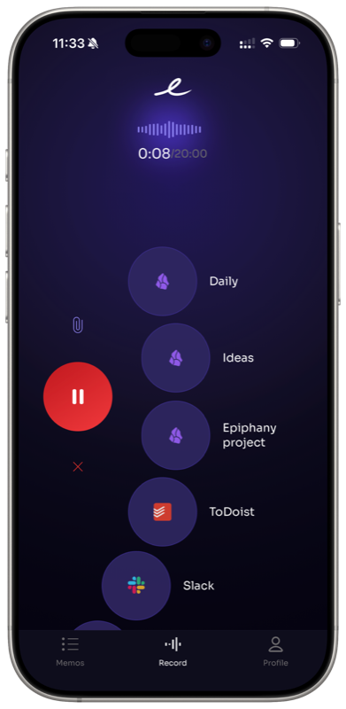
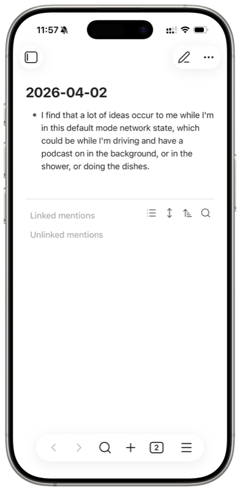
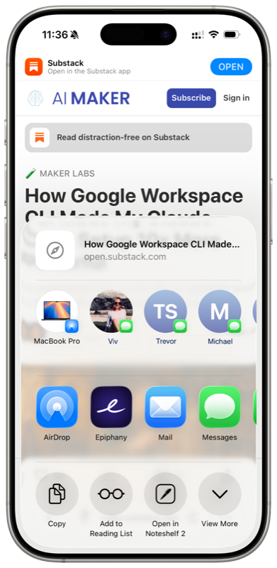
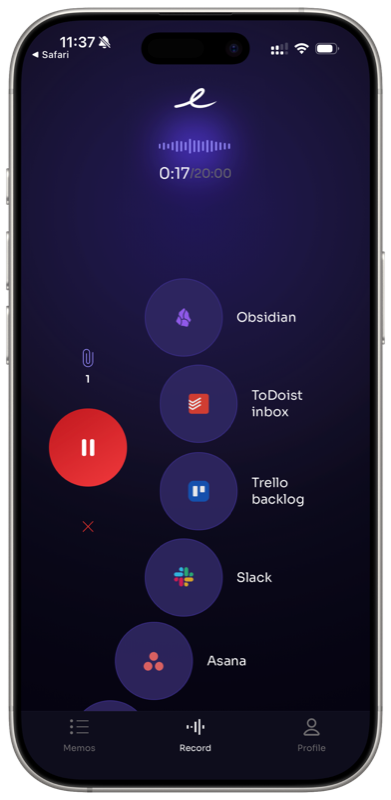
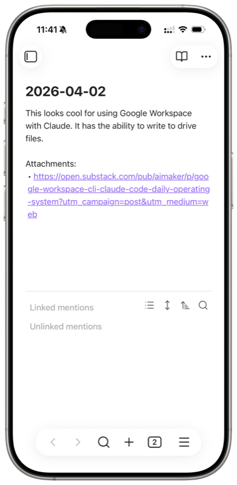
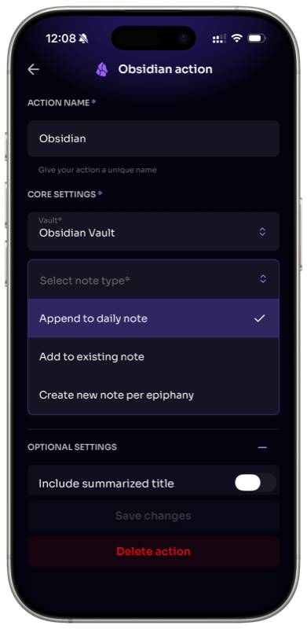
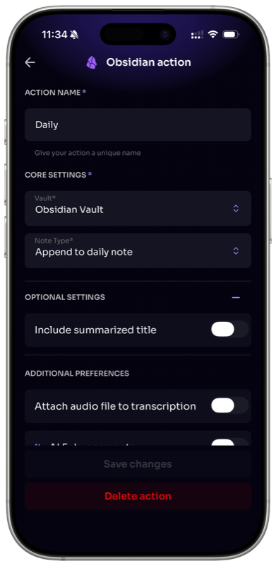

# Epiphany

Dictate a thought on your iPhone or Apple Watch. Attach a screenshot or a link for context. Next time you open Obsidian, it's all there, transcribed and right where you want it.

## Why Epiphany

Ideas don't wait for you to sit down at a keyboard. Epiphany lets you capture thoughts the moment they hit, whether you're walking, driving, cooking, or falling asleep. One tap, speak, done. You can also start right from the iOS share sheet: share a link, photo, or screenshot, and Epiphany opens so you can add voice context and send. Everything gets transcribed and synced to your Obsidian vault automatically. No copy-pasting, no export steps, no app switching.

## How it works

1. **Speak.** Open the Epiphany app on your iPhone or Apple Watch and tap to record a voice note.
2. **Forget about it.** Your note is transcribed and queued for sync.
3. **Open Obsidian.** Next time you launch Obsidian, your notes are already synced, whether that's appended to your daily note, added to an existing note, or saved as a new file.

That's it. No manual steps in between.

## Features

- **Capture from your wrist.** Apple Watch support means you can grab a thought without even pulling out your phone.
- **iPhone and Apple Watch.** Record from whichever device is closest.
- **Start from the share sheet.** See something worth saving? Share it straight to Epiphany from any app, add your voice note for context, and send.
- **Share attachments.** Send links, screenshots, photos, and files alongside your voice notes so your ideas arrive with full context.
- **Multiple destinations.** Set up different action buttons for different places in your vault. One tap sends to your daily note, another sends to a project ideas note, another to a specific topic. You decide the routing.
- **Works offline.** No signal? No problem. Record your thoughts anywhere and Epiphany will sync and process them once you're back online.
- **Automatic transcription.** Your voice is converted to clean, readable text.
- **Vault-native.** Notes land as standard markdown files, fully compatible with your existing Obsidian setup.

### Record a thought, find it in your vault

  
  

### Share from any app with attachments

  
  
  

## Getting started

Setup takes about two minutes:

1. Install the [Epiphany app](https://apps.apple.com/app/epiphany-voice/id6449386083) on your iPhone
2. In Obsidian, go to **Settings > Community plugins > Browse** and search for "Epiphany"
3. Install and enable the plugin
4. When prompted, enter the email associated with your Epiphany account
5. Enter the one-time password sent to your email

If the one-time password prompt doesn't appear automatically, open the command palette and run **Epiphany: Enter Email**.

## Where your notes land

You control where each voice note ends up in your vault, and you can set up multiple destinations with their own action buttons:

- **Append to your daily note.** Voice notes get added to today's daily note, keeping everything in one place.
- **Append to an existing note.** Send captures to a specific note you've already got in your vault.
- **Create a new note.** Each voice note becomes its own markdown file in your chosen folder.

You're not limited to one option. For example, you could have one button that appends to your daily note for quick thoughts, another that sends to a "Project Ideas" note, and another for a specific topic you're researching.

  
  

## Your vault stays private

Epiphany only writes to your vault. It never reads, scans, or accesses any of your existing files or data. The plugin receives your transcribed voice notes and attachments from the Epiphany server and places them where you've configured. That's it. Your vault contents remain entirely yours.

## Requirements

- Epiphany mobile app (iOS)
- Obsidian v0.15.0 or later

## Support

Having trouble or want to request a feature? Reach out at support@epiphanyvoice.io.
